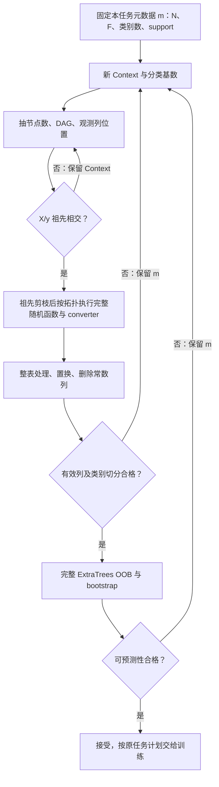

# 保留当前复杂度的 GraphSCM prior 加速审计与实现

历史工程报告。后续已删除无收益的新增接收预取与短表 pilot，并新增融合全部随机树和 full-table 渐进过滤；当前实现与复现入口见 [流程重审](prior_algorithmic_design_20261101.md)。浮点/归约顺序一致不是当前验收目标，以下一致性对照仅是当时的诊断记录。

审计基线：远端 `/ossfs/workspace/tabicl-training-perf`，提交 `5e4c163`；连接端口 52491。实验在 `/tmp/tabicl-prior-exact-20261101` 的独立副本中运行，未使用生产 checkpoint。本文讨论 `scripts/train_v2_clf_stage1.sh` 的完整 GraphSCM prior；不是 shape-only 或简化 prior 测试。最终实现默认保留当前一维分派行为，严格原始 `cdist` 语义另行选择。

## 1. 一维差异重要，但不能直接推导“训练精度下降”

需要区分三个契约：数学上最近的中心、浮点 `torch.cdist(...).argmin(-1)` 的结果、当前仓库排序搜索的结果。它们并不始终相等。数学上一维的任意正数 p 都给出相同的最近中心；浮点实现中的幂运算却可能上溢、下溢或把不同距离舍入成相同值。`argmin` 还要求距离相同时返回原始顺序的第一个中心。

当前排序实现有两个具体问题。第一，查询点落在重复中心右侧时，左邻居可能是重复中心的最后一个索引。第二，近似歧义检测仅覆盖部分近邻情况，无法涵盖所有幂运算下溢。例如 float32 中，`x=1.8e-12, centers=[0,2e-12], p=4` 的两个四次幂都可能成为零；`cdist` 返回中心 0，按绝对距离则会选中心 1。后者在数学上更近，所以恢复历史 `cdist` 也不能自动称为“数据质量更好”。

更有解释力的是重复中心这个例子：

```text
centers = [0, 0, 2]
x       = [0, .1, .2, 1.8, 2]
cdist   = [0,  0,  0,   2, 2]
当前排序 = [0,  1,  1,   2, 2]
```

这不是全局类别重命名：参考实现同一类别中的行被拆成两个类别。后续影响取决于调用者。

| 调用位置 | 索引不同是否必然改变数据 |
|---|---|
| `RandomDiscretizationFunction` | 不一定。返回的是 `targets_[idx]`；重复中心常对应完全相同的目标向量，索引差异可以消失。 |
| `CategoricalNeighborDiscretizer` | 返回的类别 ID 可以改变；`neighbor_id` 虽不改变传播的隐变量，仍会改变最终观测列或标签。 |
| `neighbor_disc` / `neighbor_func` | 相同中心可能使隐变量不变，但观测类别仍可能改变；其他浮点边界也可能改变隐变量。 |
| `neighbor_int` | 类别 ID 直接进入后续图计算，因此可能改变其他列与标签之间的关系。 |

用 512 个固定 Stage1 任务、正确开启全部过滤后审计实际调用，包括最终被拒绝的候选数据：函数 nearest-center 调用 717 次，135 次索引不同，但只有 2 次函数输出不同；分类 discretizer 调用 3293 次，93 次类别分配不同，93 次均无法用类别间一一映射解释，其中 43 次返回的中心向量不同。该向量是否继续改变下游，还取决于 converter 的 id/disc/func/int 模式。88 个任务在生成过程中遇到了至少一次索引差异，不能把它解读为 88 张最终接受的表改变。

直接比较最终接受的数据，512 个任务中 35 个（约 6.8%）`X/y` 哈希不同，7 个最终特征数不同，1 个任务结束时 RNG 状态不同。后者说明类别变化还能改变重试路径。ExtraTrees 过滤决策记录在这批任务中相同（两种实现均拒绝 150 次），但该记录不包括所有前置无效表重试，也不能说明换其他 seed 永远不影响过滤。审计插桩本身与当前基准 512 个任务的最终数据、RNG 和过滤记录全部一致，确认比较计算没有改变原始生成流。

这些结果说明它是需要明确记录的 prior 变化，不是证明泛化损失。若把新行为明确版本化、进行分布和下游质量评估，它完全可以成为另一个 prior。你要求至少保留当前复杂度，因此本次默认 `TABICL_PRIOR_1D_MODE=legacy`，保留当前行为；`reference` 才恢复原始 `cdist`。性能优化不自动改变这个选择。

## 2. 一张表怎样从零生成



### 2.1 先计划任务形状，再生成图

Stage1 的全局 batch 是 64 张表，八卡各处理 8 张，micro-batch 为 4，因此每个 rank 每步处理两次 micro-batch。默认表长 2048，最大特征数 100。组内共享长度、训练切分位置，默认每 4 张共享特征数；每张表单独抽取所要求的类别数。这里的共享不等于共享 DAG、函数参数或数据。

默认特征数来自 `[1,100]` 上连续均匀数再取整，端点质量约为内部整数的一半。支持集大小来自 `floor(2048 * U[.3,.9])`，约为 614～1843 行。要求的类别数均匀抽取 2～10；实际出现的类别可能更少，之后还需要验证训练/测试两侧的类别覆盖。

`GraphPrior.generate_dataset(params)` 的外层 `while True` 会一直尝试到接受一张表。重试时保留这次任务的特征数、类别数、长度和切分位置，重新生成 GraphSCM。不能遇到慢任务就重抽一个更简单的任务，否则会改变给定元数据下的分布。

### 2.2 每张候选表建立独立的采样上下文

GraphSCM 创建 `Context` 和共享的 `GlobalSampler`，决定连续/分类特征构成，再交给 `RandomDataset`。同一张表的组件共享采样上下文，但不同候选 GraphSCM 会重新创建。

`meta` 模式先为某个参数名抽 Beta 分布的位置和浓度，再抽具体参数。因此，一张表内的节点可以呈现相关的深度、频率、维度和尺度；不是所有节点都互不相关地均匀抽参数。`global` 复用同名值，`local` 则独立抽样。

这里有重要历史行为：`use_corrected_cat_meta_sampling=False` 时，分类超参数查询缓存的 key 和存储 key 不一致，经常会重新抽分类权重。把它“修成正常缓存”会改变随机数消耗与组件相关性，不能作为无分布变化的性能修改。本次保留。`use_corrected_num_converters`、`use_corrected_cat_sizes` 和 `ensure_iid` 同样不是纯性能开关。

分类特征比例为 `clip(U[-.5,1.2],0,1)`，乘以特征数后取整。截断本身就给全连续约 29.4%、全分类约 11.8% 的概率质量，取整会额外改变特定 F 下的概率。分类基数混合 local/meta 采样；默认未修正的基数模式最大为 9，且某些抽到的上界会更低。代码虽然传入 `max_cat_size=200`，默认开关下不代表实际会生成 200 类特征。标签是另一个具有所要求类别数的分类变量。

### 2.3 抽图，并选择哪些节点可被观测

节点数在 2～32 中通过带 meta/log 机制的整数采样取得，不是均匀分布。随机 DAG 使用 Cauchy 随机变量：抽一个全局连边偏移，再给节点抽源/目标连通性重要度，经过 sigmoid 得到边概率，用独立随机数决定是否连边，只保留前序指向后序的边。

因此，分布同时包含很稀疏和很稠密的图，不同节点的度数也有相关性。每个特征组先决定可放置特征的节点子集，再有放回地把各列放到节点上。X 和 y 可以位于中间节点、同一节点或不同节点，可以有共同隐藏原因；它不是单一的 `y=f(X)+noise` 生成器。

打开 `filter_unpredictable_graphs` 后，检查 X 和 y 的祖先集合是否有交集。如果没有，重新抽节点数、DAG 和放置位置。这一层重试仍保留当前 Context 和特征基数设定，与外层重新创建 GraphSCM 不同。祖先相交只是可能有统计关系的必要结构条件，不保证最终表足够可预测。

图中没有观测列、也不是观测节点祖先的节点原本就会被剪枝；本次没有把这种既有优化再算作新增收益。

### 2.4 节点计算的宽度不等于最终表宽

每个节点先为它承载的观测列创建 converter，确定这些 converter 需要多少隐变量，再加上随机抽取的 1～31 个潜在维度。一个分类 converter 可能需要多个隐变量。节点有多个父节点时，输入是多个父节点的隐矩阵，拼接后的输入宽度可以远大于 100。

没有父节点的根节点通过 `RandomPoints` 生成随机点：四类基础机制是 uniform、球内均匀分布（历史类名 Circle）、Gaussian，以及对 uniform/Gaussian 再作随机协方差线性变换；之后还要经过一个随机函数。所以根节点并非仅调用一次 `randn`，Circle 也不只是球面上的点。

有父节点时，`RandomMultiFunction` 选择两种关系之一：把所有父节点隐矩阵拼接，再通过一个随机函数；或者分别映射每个父节点，再通过 sum、product、max、logsumexp 等机制聚合。这些机制产生不同交互，不能仅因最终列数少而缩小内部维度。

### 2.5 八类随机函数及其真实计算

| 家族 | 当前实现的含义 | 不能为了加速直接删除的部分 |
|---|---|---|
| MLP | 随机宽度、层数、起止激活和中间激活；线性层本身使用丰富的随机矩阵。当前 `randint` 上界不含端点，宽度为 1～127、线性层数 1～3。 | 改成固定小 MLP 会改变频率、交互和光滑性分布。 |
| Tree | 1～128 棵 oblivious tree，深度 1～7；按输入列标准差抽分裂维度，从实际输入行选阈值，给叶子抽 Gaussian 向量，最后对所有树取均值。 | 减少树数/深度会改变分段结构；当前已经有 16MiB 临时量预算的按行分块。 |
| Discretization | 从输入中无放回抽中心，p 在 .5～4 的 meta/log 机制中抽取；找最近中心，返回中心经过随机线性变换后的向量。 | 不能固定 p=2，不能随意减少中心或输入维度。中心数量上界由 256 限制，`randint` 上界不含端点。 |
| Linear | 随机矩阵变换；矩阵可来自 Gaussian、随机加权、奇异值结构、kernel 和激活等家族，并有尺度/归一化处理。 | 不能把“linear”都等价为普通高斯矩阵。 |
| Quadratic | 对至多 20 个抽样输入维度，加常数维度，抽每个输出的双线性系数，计算二次交互。 | 20 维上限是原有 prior 定义，本次保留，不进一步降低。 |
| GP | 256 个随机 Fourier 特征；重尾频率分布、product 或旋转/加权输入几何，最后 `cos(XW+b) @ V`。 | 已经是 RFF 机制，不存在可以凭空省掉的 N×N Cholesky；降低频率数是改变现有机制。 |
| EM assignment | 从输入有放回地抽 2～max(16,2*out) 个中心并加噪声，抽各中心尺度；完整距离矩阵经过 q 次幂、softmax，再作随机线性映射。 | 需要所有中心的软分配，不能用最近中心替代。 |
| Product | 两个既有子函数逐元素相乘；子函数来自 GP/tree/disc/linear/quad。 | 子函数组合正是产生高阶交互的一部分。 |

仓库现有 `CheapRandomFunction` 是 Product 和部分 converter 为限制递归而使用的历史类名，不是本次引入的 cheap component。本次保留它原有的五类分布和调用次数，也保留所有八类顶层函数。完整模型复杂度不能用“八个家族各 1/8”概括：meta 分类采样、嵌套调用、层内线性函数和拒绝采样都影响实际执行频率。

随机 activation 本身还包含一层组合：通常是 Standardize → RandomRescale → 基础非线性 → Standardize。基础族包括常用 Torch 激活、符号/指示/周期/幂函数，也包括行内 rank、argsort、softmax、is-max 等跨维变换；另外有随机幂类激活。多次标准化看似重复，实际上常被非线性和随机缩放隔开，不能直接合并。跨维激活也意味着“各隐维独立生成再拼起来”不保留原函数。

这里按可执行代码解释，而不是照抄 `GraphSCM` 的旧 docstring；后者仍提到 flow、独立 generalized-GP 等项目，与当前 `RandomFunction._fit` 的实际分派列表不完全一致。默认 Stage1 是这些合成图表，没有混入真实表，也没有另加专门的缺失值、时间序列或关系数据库生成器。类别比例由转换和隐变量分布自然产生，后续有效性检查不会强制平衡它。

128 张最终接受的表的独立结构审计中，图执行 185 次；每次图平均 12.28 个节点，其中平均 10.04 个参与计算，最大 32。所有已拟合函数（含嵌套）的输入宽度中位数为 6、p95 为 79.35、最大 770。线性函数拟合 5058 次、Tree 1362 次、Discretization 1358 次、Quadratic 1341 次、GP 1299 次、EM 894 次、Product 866 次、MLP 856 次。这不是顶层家族概率统计，也不能拿 185/128 当作所有内部图结构拒绝率。

### 2.6 节点归一化和 converter 会影响下游图

生成节点矩阵后，先列标准化，再乘随机列重要度，重要度自身做 RMS 归一化；接着按配置做节点 L2Normalize。这里的 L2Normalize 是全表行向量范数的 RMS 形成的标量缩放，不是让每一行都成为单位向量。

converter 随后读取节点矩阵中为该观测列预留的一段，返回“继续在图中传播的值”和“最终输出列”。传播值会写回节点矩阵，因此类别化不仅影响当前列，也会影响它的子孙节点。

数值 converter 默认在 identity 和 Kumaraswamy warping 中选择，额外 activation warping 默认关闭。历史 `use_corrected_num_converters=False` 会把变换值放入传播分支而不是直接输出分支；还涉及 tensor view/写回语义。不能随手改为直觉上更合理的输出路径。

分类 converter 有七种模式：`neighbor_id/disc/func/int` 和 `softmax_id/disc/int`。neighbor 路线从当前输入行选中心，用随机 p 的最近中心作为类别；softmax 路线对标准化值施加随机尺度/偏置，通过 multinomial 抽类别，再取随机 embedding。id 保留原隐变量，disc 传播离散 embedding，func 再施加既有随机子函数，int 把类别整数用于后续图计算。

可选独立 Gaussian 噪声默认关闭，但这不代表整张图是无随机性的：根节点、中心噪声、类别 multinomial 等仍随机。最后节点还可乘 .1～10 的随机节点重要度。

### 2.7 这里不是“先固定机制，再独立抽任意多行”的简单模型

默认 `ensure_iid=False`。第一次调用每个 lazy transformer 会先 fit 再 transform，fit 和 transform 使用同一批 2048 行。树阈值、离散中心、部分归一化统计都来自这批行；EM 中心也来自这批数据。因此整个有限表的分布依赖 N，条件于拟合后的机制时不能把这些行简单当成重新独立抽样。

把一次 8192 行生成拆成四张 2048 行表，或者把一次 fit 的函数复用成很多训练任务，会改变表内/表间相关性、阈值和中心的分布。即使每一张表看起来都很复杂，也不等于保持当前 prior。`ensure_iid=True` 会先额外运行一批行进行 fit，再生成输出，是另一个、更昂贵的设定。

### 2.8 从观测列到最终接受的表

图计算返回观测特征后，拼接分类/数值列，把 X 转成 float，做阈值 4 的离群值处理和全表标准化，随机置换特征列，随机置换类别标签。标准路径补零到 100 列；compact 路径可以延迟 padding，但需要保持后续过滤语义。

删除常数列后，至少要剩一个有效特征。分类任务检查训练/测试的类别集合相同且至少有两个类别，必要时最多尝试 10 次随机行重排；仍然无效则回到外层重新生成 GraphSCM。这不是强制类平衡，也不是“要求每个类别样本数相等”。

最后在整张 N 行表上训练一个固定种子的 ExtraTreesRegressor：25 棵树、最大深度 6、bootstrap、OOB 预测、单线程。它不是仅在 ICL support 前缀拟合。分类标签转 one-hot，二分类去掉一维；用 OOB 预测相对常数均值预测的逐行平方误差改进，做 200 次 bootstrap，p 值小于 .05 才通过可预测性过滤。这里 bootstrap 只是对误差重采样，不会重训 200 个森林。

重要细节：即便 compact 传输只保留有效列，过滤输入仍补至原来的 100 列，因为 sklearn 的随机特征选择会受到补零列数影响。去掉这些补零列再拟合同一棵森林，也可能改变过滤结果。

给定任务元数据 m，最终分布可写成：

```text
p(m) × q(机制 θ, 整张表 D | m) × 1[通过全部有效性与预测性检查] / Z(m)
```

所以改变过滤器、给慢任务设超时后重抽、删重试、回退到简单生成器，都会改变接受后的分布。本次不做这些修改。

## 3. 繁杂中哪些有价值，哪些确实冗余

图、丰富函数、分类反馈、随机尺度、meta 采样和预测性过滤共同定义了当前数据的复杂度。不能仅因调用链长，就认为某一层是多余的。原代码也已经做了祖先剪枝、Discretization 只在中心上计算目标向量、GP 的 RFF、二次项维数控制、Tree 按行分块和 CPU 线程预算。

可以直接消除的是执行冗余：对相同输入行重复计算同一组距离；为了得到一个最近索引而物化完整距离矩阵；已经不再有后继使用的隐变量仍一直占内存。它们都不需要改变生成机制。

结构审计中，4384 次可审计距离调用有 407 次实际命中重复行压缩，距离行数由 7,941,791 降为 7,194,041，约减少 9.4%。这说明精确去重有机会，但不是所有隐变量都低基数，不能假设它单独带来数倍加速。

前一轮完整 prior profile 中，图生成约占 CPU 时间 81.9%，ExtraTrees/过滤约占 17.7%；距离调用约占整体 35%，已经包含在图生成里，不能再相加。那轮配置和本次工作进程数不同，绝对耗时不能直接比较。若其他计算不变，即使把 35% 的距离计算完全删掉，理论上也只约 1.54 倍加速；把它减半约为 1.21 倍。

## 4. 本次实现的完整执行算法

生成模型仍是上面的完整 GraphSCM；改的是它的执行后端。三处代码修改如下。

1. `_distance.py` 对有限的 CPU float32/float64、非 p=2 距离进行确定性的重复行探测。行数/中心数太小则不去重；多维时先探测前 64 行的前四列，只有值得进一步检查才做完整 `unique(dim=0)`；最终至少省去 12.5% 的行才采用。探测仅决定是否使用等价计算，不抽随机数、不删行、不改中心，最后按 inverse 恢复原始行顺序。NaN/Inf、其他设备和类型、特殊形状回到 Torch 参考实现。

   压缩发生在中心等参数已经按原始 N 行完成抽样之后。不会拿 unique 后的行重新 fit：那会改变中心抽中的概率、树阈值和所有按经验分布采样的机制。中心的重复项也保留，确保原始中心顺序与类别含义不变。

2. 新增 `_nearest_cpu.cpp`，融合“计算距离”和“选最近中心”。每行按原始顺序扫描中心，按原维度顺序累加 `abs(x-c)^p`。如果非负部分和已不小于当前最优完整和，则这个后到的中心不可能获胜，立即停止计算剩余维度。完成的候选仍计算最终的 `sum^(1/p)` 后才比较，保留根运算舍入导致的 tie；先出现的中心优先。p=1 使用对应专门路径。它是精确的计算剪枝，不是近似最近邻，不降低维度、不改 p、不减少中心数量。最坏情况复杂度仍为 O(NCD)，实际少做部分幂运算，并且不创建 N×C 距离输出矩阵。

3. `_function.py` 中 EM 距离调用使用 `compact_cdist`：只把重复行的距离计算一次，然后恢复完整距离矩阵。softmax 和后续线性映射仍看到原始行数和中心数，保留全部软分配。`_graph_function.py` 在既有祖先剪枝后计算每个节点的最后使用位置，最后一个活跃子节点计算完就释放父节点引用；已经抽取的输出 view 独立保留所需存储。执行顺序、fit 顺序和随机数调用不变。这有助于内存生命周期，不把它单独宣称为已测得的显著吞吐收益。

原生实现依据目标环境 Torch 2.8 的 CPU 距离累加和最终幂运算顺序进行实现，参考 [PyTorch 2.8 DistanceOpsKernel.cpp](https://github.com/pytorch/pytorch/blob/v2.8.0/aten/src/ATen/native/cpu/DistanceOpsKernel.cpp)。构建禁用 fast-math 和浮点乘加收缩。p=2 保留 Torch，因为它可按矩阵大小选择 GEMM 路线，改变行批大小可能改变舍入；p 转到实际标量类型后恰好成为 2 时原生实现也回退 Torch。

这里的逐位一致是本机 Torch/编译器下的测试结论，不是对未来任意 Torch、编译器和 ISA 的无条件承诺。升级环境应重跑差分测试。原生库需在主进程启动 workers 前单独构建，训练 worker 不执行 JIT 编译。未设置原生库路径时自动使用 Python/Torch 实现；1D 兼容选择在两条路径中都生效。

## 5. 验证方法和结果

基准先规划相同任务，再用 `SeedSequence([42,task_id])` 为每个任务独立设置 Python、NumPy、Torch seed。每个任务记录最终 X/y 哈希、最终有效列数、结束时三类 RNG 状态哈希和每次 ExtraTrees 过滤决策。计时覆盖完整生成、全部重试和过滤；多进程 wall time 包含 worker 启动和退出。因此不能把短批次的吞吐直接外推为无限流的稳态吞吐。

实验也固定 `PYTHONHASHSEED=42`：`RandomDataset` 迭代由特征组字符串组成的 set，仅重置三类随机数而不统一 worker 的 Python hash seed，仍可能在不同进程中以不同顺序抽特征放置。基准脚本为新 spawn 的 worker 显式补上这个默认值并记录它；生产生成器的遍历逻辑没有随本次性能修改一起改变。

复核发现早期 CPU 基准存在配置遗漏：任务参数启用了过滤，但 worker 中的 `GraphPrior` 仍使用默认配置，最后的 ExtraTrees 读取的是 worker 配置，实际没有执行。那些 `compat-*`、`reference*`、`native*` CPU JSON 保留作诊断原始记录，不作为完整 Stage1 性能证据；`analysis.json` 的 CPU 汇总只读取修正后的 `filtered-*`。结构审计、完整 prior 单元测试和下面的八卡训练本来就正确开启了过滤，不受此遗漏影响。修正后的脚本同时检查 worker 配置与任务配置一致，测试强制第一次过滤拒绝，验证完整重试路径。

### 5.1 对当前默认 prior 的最终兼容测试

从未修改的当前代码重新运行完整过滤对照，最终代码设为默认 `legacy`：

| 任务数 / 行数 / workers | 当前 CPU 总秒 → 新 CPU 总秒 | 当前 wall → 新 wall | 吞吐提高 | 任务 p99：当前 → 新 |
|---|---:|---:|---:|---:|
| 512 / 2048 / 8 | 292.75 → 238.16 | 42.10 → 35.32 s | 19.2% | 3.19 → 2.08 s |
| 1024 / 2048 / 56 | 697.12 → 578.82 | 20.84 → 19.15 s | 8.8% | 3.88 → 2.72 s |
| 512 / 4096 / 8 | 499.23 → 385.88 | 71.17 → 56.03 s | 27.0% | 6.35 → 4.07 s |

三组对照均为零数据差异、零 RNG 状态差异、零有效列数差异、零 ExtraTrees 过滤记录差异。CPU 总工作量分别降低约 18.6%、17.0%、22.7%。两种实现的 ExtraTrees 拒绝次数分别同为 150、320、121；这不包括所有前置无效表重试，也不能直接当作拒绝率的分母。1024 任务组包含前 512 个任务，2048/4096 组也不是互不重叠的独立种子，不能累计为独立样本量。

2048 行、8 workers 时每张接受表 CPU 均值由 .572s 降为 .465s；56 workers 时由 .681s 降为 .565s。wall 包含进程启动，分别为 12.16 → 14.49 和 49.14 → 53.48 张/秒；后者尚未扣除 GPU 训练进程的 CPU 开销，不能直接当成训练时持续供给能力。高并发下 CPU 竞争和进程启动会削弱 wall 收益，不能把低并发生成器吞吐直接当作训练收益。这是保留当前一维行为的结果，没有通过恢复原始 `cdist` 来换取新分布。

原生路径的 309 项测试通过，覆盖新距离/完整 prior 测试以及既有 CPU budget、DataLoader、node pool、窗口调度和训练配方；Torch 回退路径另有 128 项测试通过。之后新增的两项基准配置/拒绝重试回归测试也通过。新文件现在包含 103 项测试，覆盖重复中心、float32/64、特殊 p、极端尺度、NaN/Inf、非连续输入、空行/零维、随机差分、隐变量生命周期、完整过滤 prior 及其 RNG，以及基准本身的过滤路径。测试使用相同环境的 Torch 实现作参考；不能把有限测试提升为所有未来平台的证明。

### 5.2 八卡真实训练验证

使用 Stage1 配方，八卡、每轮 200 步，`COMPILE_FRONTEND=all`，既有逐 rank 预热、`global_sparse` ICL、完整 GraphSCM、每 rank 8 个 DataLoader worker、prefetch=8。为了比较相同任务配置，固定 `PRIOR_IN_ORDER=True`，无额外 prior schedule。计时有流水线诊断插桩；统计后 100 步，以所有 rank 的训练结束时间最大值计算连续步间隔。全程 wall 另外包括启动、预热、最终 checkpoint 写入和 worker 退出。

两条精度路线各有一组当前实现/新实现的短程对照，共四轮训练；使用已有 Inductor 缓存，不是从空缓存冷编译的总成本。尚无多轮重复估计的误差条，长尾对 100 步均值有明显影响，因此下面是这组实测值，不是长期训练收益的保证。

| BF16 指标 | 当前实现 | 新原生实现 |
|---|---:|---:|
| 后 100 步平均间隔 | 0.7227 s | 0.5882 s |
| 步间隔中位数 | 0.3343 s | 0.3297 s |
| 步间隔 p95 | 3.1240 s | 2.1842 s |
| 每步最慢输入等待的均值 | 0.4027 s | 0.2707 s |
| 每步各 rank 输入就绪时间跨度的均值 | 0.4085 s | 0.2768 s |
| 200 步全程 wall | 277.60 s | 251.10 s |
| 预热最大 rank 用时 | 29.28 s | 29.51 s |

后段训练吞吐提高 22.9%，平均步间隔减少 18.6%；200 步全程 wall 减少 9.5%。两轮 8×200=1600 个 rank-step 的 N、support、F 和 micro size 配置全部相同；后段平均 F=50.80125、support=1246.31375、F²=3387.95125，峰值显存都为 18.57GiB，没有 OOM 或非有限 loss。这验证了实际训练等待减少，并不只是 CPU 微基准变快。

rank0 的 prior wait 均值在两轮中都只有约 0.00012s，单看它会错误地认为没有 CPU 瓶颈。当前实现的主要输入等待出现在 rank3（约 .269s/step）和 rank7（约 .134s/step），新实现主要在 rank5（约 .261s/step）。其他 rank 多出来的时间进入 backward/DDP 等待。rank0 因微小的固定开销在多数“无明显等待”的步骤里最后进入训练，这不代表它贡献了主要 stall；应按输入就绪跨度和累计等待来排序，而不是只数“最后到达次数”。

这里只验证了形状/切分顺序相同，没有在 GPU 训练计时路径中额外对全部输入计算哈希。两轮训练 loss 也不是逐位一致：最大差约 .00151，1600 个 rank-step 中 1584 个有差异；未在本实验中隔离 GPU/优化器非确定性，不能把它直接归因于 prior，也不能声称整个训练逐位复现。prior 的逐位和 RNG 等价证据来自前述独立完整生成对照。200 步属于性能实验，不能代替下游准确率/泛化评测。

FP32 控制组也使用上述 DataLoader 配置，以单独比较生成器变化：

| FP32 指标 | 当前实现 | 新原生实现 |
|---|---:|---:|
| 后 100 步平均间隔 | 0.7721 s | 0.6744 s |
| 步间隔中位数 | 0.6087 s | 0.6142 s |
| 步间隔 p95 | 0.6907 s | 0.6989 s |
| 步间隔 p99 | 3.1728 s | 0.9446 s |
| 每步最慢输入等待的均值 | 0.1846 s | 0.0707 s |
| 每步各 rank 输入就绪时间跨度的均值 | 0.1893 s | 0.0808 s |
| 200 步全程 wall | 296.23 s | 264.23 s |
| 预热最大 rank 用时 | 33.73 s | 33.36 s |

后段吞吐提高 14.5%，平均步间隔减少 12.7%，全程 wall 减少 10.8%。主要减少少数长等待，普通步的中位数和 p95 并没有改善。两轮 1600 个 rank-step 的形状/切分配置全部相同，峰值显存均为 55.80GiB，零 OOM、loss 有限；loss 最大差约 .000744，同样不是逐位复现训练。脚本的 FP32 默认 node-pool/balanced 路线不等于这个控制配置，因此不能把该对照的结果直接当作默认 FP32 配方收益。

## 6. 下一轮更大收益应该怎样争取

FP32/BF16 是模型训练精度路线，当前 CPU prior 的主要数据生成仍是 float32；把模型切到 BF16 不会自动让这套 CPU 图生成快一倍。相反，模型消费加快后，输入产能不足和队列长尾会变得更加显眼。当前机器虽然可见 192 个逻辑 CPU，cgroup CPU 配额约为 69.76 核；不能按 192 个持续可用核来估算 worker 吞吐。

首先以“接受一张表的 CPU 秒数”和“所有 rank 的步完成间隔”为指标，不只看 rank0 的 `prior_time`。一个 rank 等输入时，其他 rank 可能在 backward/DDP 中等待，它们的 `train_time` 会被放大，不能把这些等待当作模型本身变慢。需要将每步各 rank 的输入就绪、训练开始/结束、micro-batch F/N/support 和 CPU 队列状态放到同一时间线上。

对于长尾，完整复杂度约束下适合的是给既定任务设置独立 seed，把执行顺序与任务分布分开；保留计划中的消费顺序，允许 worker 提前完成后续任务，使用有字节上限的重排缓冲。按完成顺序消费会改变有限训练前缀、步内组合以及结束时未消费的尾部；不能直接把最慢的几个任务删除。若有界窗口内的所有任务最终都被消费，则窗口内多重集合可保持，不能武断地说完成顺序一定改变无限流的渐近边际分布。当前仓库已有 task plan/node-pool/compact transport 基础，下一步应在这些机制上做 CPU 容量和排队诊断，而不是再叠一个无界池。

调度可以缓解某个 rank 的偶发断粮，但无法突破 CPU 总吞吐。若训练无等待需约 64/T 张表每秒，而生成端持续低于这个数，无论 prefetch 多大都会耗尽；更深队列只会推迟暴露。反过来，容量足够时，更合理的全节点共享任务池和可重排预取才可能大幅减少同步尾部。本次距离内核也降低了任务 p99，正好有利于这个目标。

例如，假设目标平均步长为 .33s，则需约 194 张表/秒；用本次新实现低并发测得的 .465 CPU 秒/表和约 70 核配额做理想线性估算，上限也只有约 150 张/秒，尚未扣除训练进程、通信和传输的 CPU 用量。这里 .33s 来自典型快步量级，不能把中位数当作实际无等待平均值；这个计算只是说明应先用测得的目标 GPU 平均步长做产能核算，而非认为队列调优必定能填满 GPU。

在算法层面，下一项仍可保留全部 prior 的工作是将 Tree 的分裂判断、叶索引和求均值融合，避免 N×树数×输出维度的临时 gather；或者把更多确定性节点操作下沉到原生执行计划。这里必须先对 Torch 当前树均值的浮点归约顺序做差分验证，不能只在数学公式上相等就承诺逐位一致。GP/MLP 的矩阵乘法还可能受益于按尺寸选择 BLAS 线程预算，但在 64 个生成 worker 下“每个调用都开多线程”通常会过度订阅。现有 CPU permit 机制应该统一覆盖，而不是另开线程池。

如果目标是接近 GPU 极限而单机 CPU 的总容量仍不足，保留全部复杂度的现实路径是独立 CPU 生产节点或离线生成完整新任务。离线缓存应给每张表保存 seed、元数据、接受后数据和 prior 版本，每张按计划消费一次，不通过反复复用少量图/表制造吞吐。它减少在线等待，不减少总生成工作和总资源成本。100 列上界下每步 64×2048 行的 float32 X 加 int64 y 约 53.5MB；50 万步约 26.7TB，实际按有效列数可下降，因此需要分片、字节预算和滚动生产，不宜一次落盘全部 padding 数据。

改变图提案分布并用 importance weighting 校正，在理论上可研究，但当前默认训练接口按普通平均损失消费表；缺少正确权重与归一化时不能保持目标分布。直接按成本拒绝、设中心数/树数更低的上限、复用已 fit 机制、删过滤器和添加 cheap mixture 都不是本次实现路径。

跨论文增加真实表、时序或关系结构是 prior 研究方向，不是已经证明兼容当前 prior 的性能优化。当前需求优先保证现有全部机制，再用相同 CPU 预算下的训练吞吐和后续泛化实测决定是否引入新分布。

## 7. 已交付代码与使用方式

生产目录 `/ossfs/workspace/tabicl-training-perf` 已放入以下实现，保留为未提交修改，便于审阅：

- `src/tabicl/prior/graph_lib/_distance.py`：兼容模式、重复行压缩、原生分派及 Torch 回退。
- `src/tabicl/prior/graph_lib/_nearest_cpu.cpp`：精确融合最近中心内核。
- `src/tabicl/prior/graph_lib/_function.py`：EM 使用等价距离执行路径。
- `src/tabicl/prior/graph_lib/_graph_function.py`：按最后使用位置释放隐变量引用。
- `tests/test_prior_exact.py`：103 项新增差分/完整生成及基准回归测试。
- `scripts/build_prior_exact.py`：在训练前构建原生库。
- `scripts/benchmark_prior_exact.py`：完整 prior 的固定任务性能和数据校验基准。

启用命令如下。Python 必须与训练使用的 Torch 环境一致；本次实验使用 `/tmp/tabicl-review-20261101-venv/bin/python`，安装了所需依赖。路径是本次环境的复现实验位置，机器清理 `/tmp` 后需要重建环境和库。

```bash
cd /ossfs/workspace/tabicl-training-perf
export PATH=/tmp/tabicl-review-20261101-venv/bin:$PATH
python scripts/build_prior_exact.py --build-directory /tmp/tabicl-prior-exact-build
export TABICL_PRIOR_DISTANCE_LIBRARY=/tmp/tabicl-prior-exact-build/tabicl_prior_exact_cpu.so
export TABICL_PRIOR_1D_MODE=legacy
PYTHONPATH=src python -m pytest -q tests/test_prior_exact.py tests/test_prior_cpu_budget.py

# BF16；沿用脚本中你已有的训练与 checkpoint 配置
TRAIN_DTYPE=bfloat16 COMPILE_FRONTEND=all bash scripts/train_v2_clf_stage1.sh

# FP32：另一次训练启动时使用
TRAIN_DTYPE=float32 COMPILE_FRONTEND=all bash scripts/train_v2_clf_stage1.sh
```

先构建一次，之后所有 worker 只加载已有 `.so`，不会逐 rank/worker 竞争编译锁。未设置 `TABICL_PRIOR_DISTANCE_LIBRARY` 时使用 Torch 回退；恢复 `reference` 是显式的 prior 选择，不是启用原生库的必要条件。

独立测生成性能，不启动训练：

```bash
PYTHONPATH=src python scripts/benchmark_prior_exact.py \
  --tasks 512 --workers 8 --rows 2048 --output /tmp/prior-native.json
```

复现对照需要保持任务规划、种子与过滤模式一致；当前 benchmark 不再提供旧的 `--reference` 参数。一维语义由 `TABICL_PRIOR_1D_MODE` 显式选择。历史实验配置、逐任务哈希、逐 rank 时间线和分析结果保存在远端 `/tmp/tabicl-prior-exact-20261101`；归档不含训练 checkpoint。
